# RDRA ダイアグラム

> `rdra.py diagrams` で表から生成。手で編集しない。点線・橙色は仮説。

## システムコンテキスト


## 要求モデル

```mermaid
flowchart LR
  g1{{"G-01 輸入した商品をタイムリーに紹介し、Web で顧客に直接販売する"}}
  g2{{"G-02 顧客と直接つながり、商品に対する顧客の声をダイレクトに把握して商品開発につなげる"}}
  r3["R-01 [機能] 顧客が Web で商品を選び、決済情報と送付先を入力して購入できる"]
  g1 --> r3
  r4["R-02 [機能] 営業が仕入れた商品を Web の取り扱い商品として登録・削除できる"]
  g1 --> r4
  r5["R-03 [機能] 顧客がオーダー商品の現在の状態を確認できる"]
  g1 --> r5
  r6["R-04 [機能] 顧客が会員登録できる。会員登録しなくても購入できる"]
  g1 --> r6
  g2 --> r6
  r7["R-05 [機能] 顧客が出荷前のオーダーを Web でキャンセルできる"]
  g1 --> r7
  r8["R-06 [機能] 決済システムの入金情報通知を受けてオーダーと照合し、照合できないもの・金額が異なるものだけオーダー部門が確認する"]
  g1 --> r8
  r9["R-07 [機能] 出荷指示の前にオーダー別の在庫を確認し、在庫切れのオーダーを入荷待ちにする"]
  g1 --> r9
  r10["R-08 [機能] 入荷システムから送られる入荷情報で、入荷待ちのオーダーの入荷待ちを解除する"]
  g1 --> r10
  r11["R-09 [機能] 入金が確認されたオーダーの出荷指示を、そのまま出荷システムへ連携する"]
  g1 --> r11
  r12["R-10 [機能] 取引先への発注(在庫切れ時の追加発注、新規商品の発注)を記録する"]
  g1 --> r12
  r13["R-11 [機能] 営業が商品の特性と売れた時期・売れた場所を管理し、売れた場所をマップ上に表示できる"]
  g1 --> r13
  r14["R-12 [機能] 売上を週単位で集計し、月単位でも見られる"]
  g1 --> r14
  r15["R-13 [機能] 購入した顧客が商品のレビュー・感想を Web で投稿できる"]
  g2 --> r15
  r16["R-14 [機能] 営業が商品ごとにレビュー・感想を集計し、商品開発の検討に使える"]
  g2 --> r16
  r17["R-15 [機能] 営業が、今後追加発注しない在庫商品をマークし、売れ筋商品の在庫量を多くできる"]
  g1 --> r17
  r18["R-16 [機能] 経営者が売上の状況を見られる"]
  g1 -.-> r18
  r19["R-17 [機能] 多様な顧客のニーズに沿えるように、入金手段を多く用意する"]
  g1 --> r19
  r20["R-18 [ポリシー] オーダー処理は新たに用意するオーダー部門に集約し、営業は戦略的な商品管理の仕事にシフトする"]
  r21["R-19 [非機能] 保守性を考え、使用する技術を統一する"]
  g1 --> r21
  r22["R-20 [ポリシー] 直営店と Web の在庫は共有しない。直営店での販売・店舗の在庫は対象外"]
  r23["R-21 [機能] オーダーを受理したことと支払い方法を顧客にメールで通知する"]
  g1 --> r23
  r24["R-22 [ポリシー] 入金額が不足する場合は差額の追加支払いを依頼し、多すぎる場合は差額を返金する"]
  r25["R-23 [ポリシー] 返品はオーダー部門がメールもしくは電話で受け付ける"]
  r26["R-24 [機能] オーダー部門が配送会社からの配送終了のメール通知を確認し、オーダーを完了にできる"]
  g1 --> r26
  r27["R-25 [ポリシー] 出荷は朝・昼・夕方の各3時間単位の締め毎に行う"]
  b28(["会員登録する"])
  r6 --> b28
  b29(["購入する商品を選びカートに追加する"])
  r3 --> b29
  b30(["購入指示を行い決済情報と送付先の情報を入力する"])
  r3 --> b30
  r19 --> b30
  b31(["ABC商事からのメールを確認して支払う"])
  r3 --> b31
  r23 --> b31
  r19 --> b31
  b32(["オーダー商品の状態を確認する"])
  r5 --> b32
  b33(["出荷前のオーダーをキャンセルする"])
  r7 --> b33
  r24 -.-> b33
  b34(["仕入れた商品を取り扱い商品として登録・削除する"])
  r4 --> b34
  b35(["商品の特性と売れた時期・売れた場所を管理する"])
  r13 --> b35
  r14 --> b35
  b36(["週単位で売上を分析し品揃えを検討する"])
  r14 --> b36
  b37(["追加発注しない在庫商品をマークする"])
  r17 --> b37
  b38(["売れ筋商品の在庫量を多くする"])
  r17 --> b38
  b39(["新規商品を発注する"])
  r12 --> b39
  b40(["売上の状況を見る"])
  r18 -.-> b40
  b41(["オーダーを確認し受理をメールで通知する"])
  r20 --> b41
  r23 --> b41
  b42(["入金情報をオーダーと照合する"])
  r8 --> b42
  b43(["在庫を確認し在庫切れのオーダーを入荷待ちにする"])
  r9 --> b43
  b44(["在庫切れのとき取引先に追加発注する"])
  r12 --> b44
  b45(["入金が確認されたオーダーの出荷指示を行う"])
  r11 --> b45
  b46(["入金の不足分の追加支払いを依頼する"])
  r24 --> b46
  b47(["入金の過多分を返金する"])
  r24 --> b47
  b48(["返品を受け付ける"])
  r25 --> b48
  b49(["配送終了を確認しオーダーを完了する"])
  r26 --> b49
  b50(["締め毎に商品を出荷する"])
  r11 --> b50
  r27 --> b50
  b51(["入荷情報を入荷システムに入力する"])
  r10 --> b51
  r12 -.-> b51
  b52(["レビュー・感想を投稿する"])
  r15 --> b52
  b53(["レビュー・感想を集計し商品開発に使う"])
  r16 --> b53
  classDef hyp stroke-dasharray:5 5,stroke:#d97706,color:#92400e
  class r18 hyp
```

## ビジネスコンテキスト

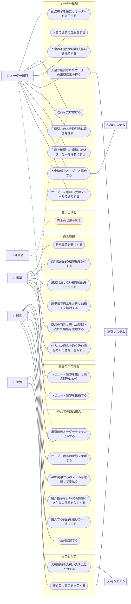

## 業務フロー

### Webでの商品購入 / 会員登録する

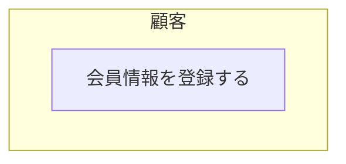

### Webでの商品購入 / 購入する商品を選びカートに追加する

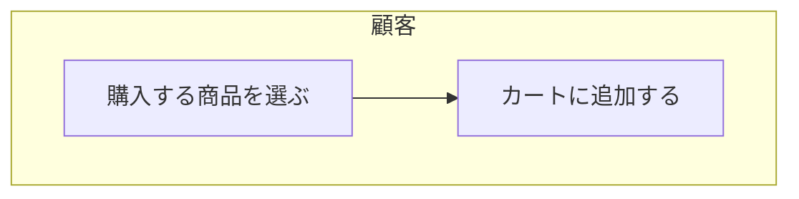

### Webでの商品購入 / 購入指示を行い決済情報と送付先の情報を入力する

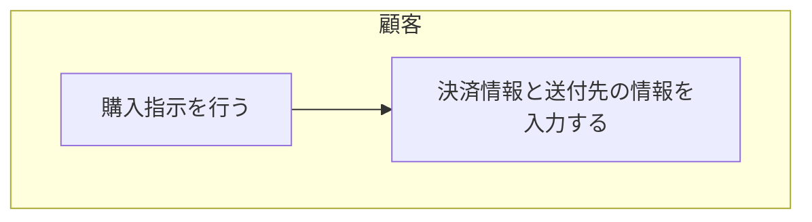

### Webでの商品購入 / ABC商事からのメールを確認して支払う

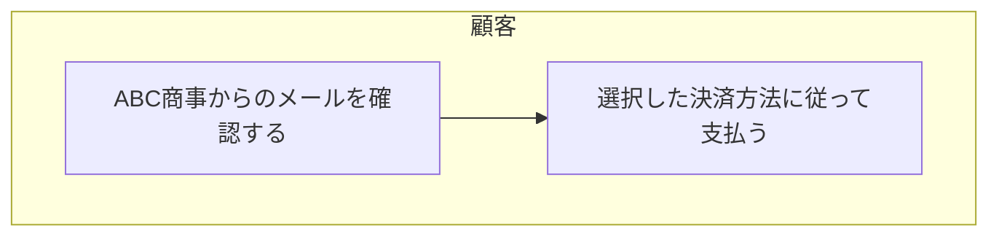

### Webでの商品購入 / オーダー商品の状態を確認する

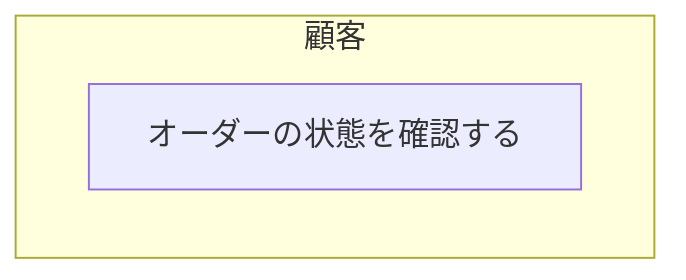

### Webでの商品購入 / 出荷前のオーダーをキャンセルする

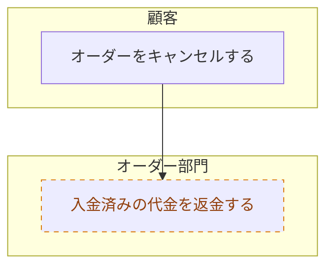

### 商品管理 / 仕入れた商品を取り扱い商品として登録・削除する

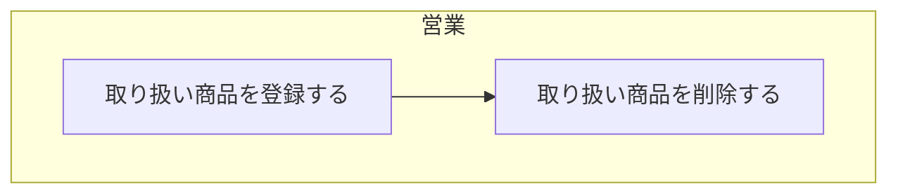

### 商品管理 / 商品の特性と売れた時期・売れた場所を管理する

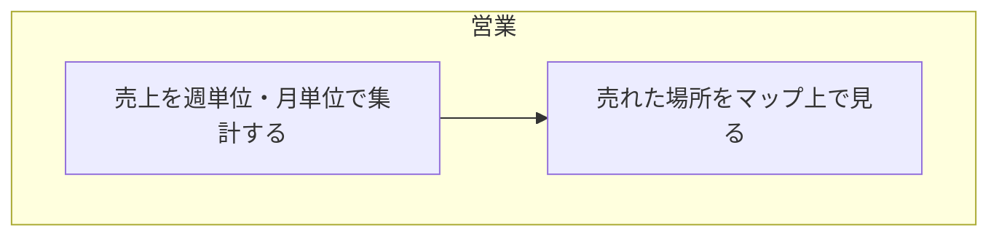

### 商品管理 / 週単位で売上を分析し品揃えを検討する

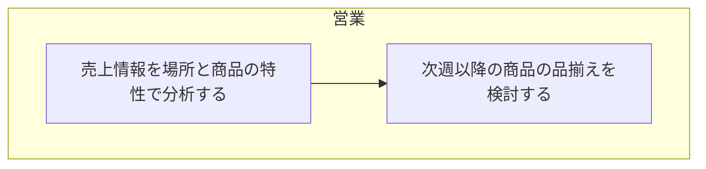

### 商品管理 / 追加発注しない在庫商品をマークする

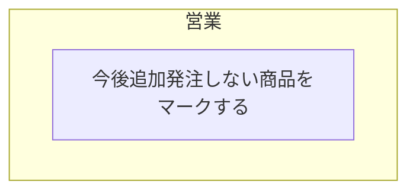

### 商品管理 / 売れ筋商品の在庫量を多くする

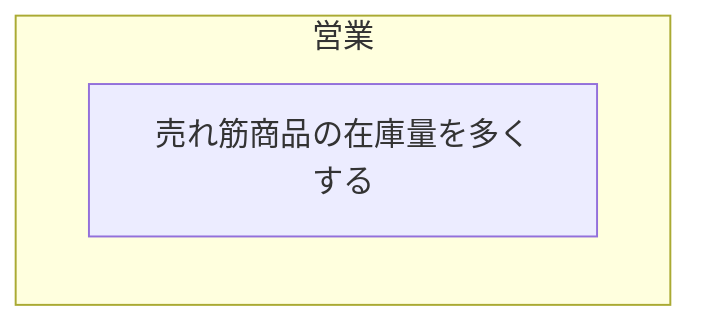

### 商品管理 / 新規商品を発注する

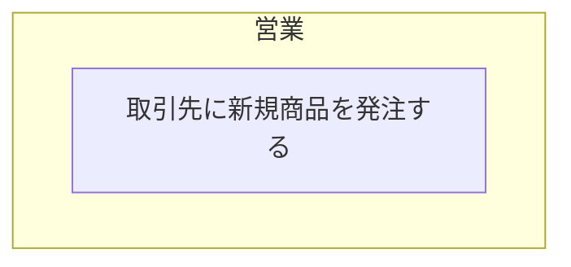

### 売上の把握 / 売上の状況を見る

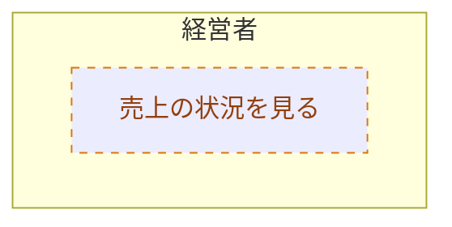

### オーダー処理 / オーダーを確認し受理をメールで通知する

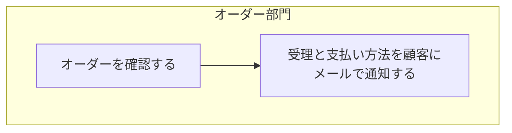

### オーダー処理 / 入金情報をオーダーと照合する

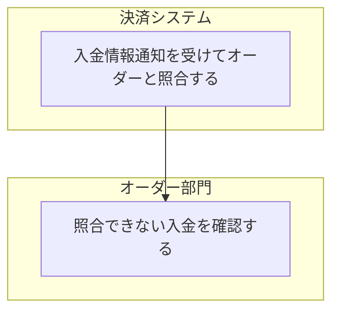

### オーダー処理 / 在庫を確認し在庫切れのオーダーを入荷待ちにする

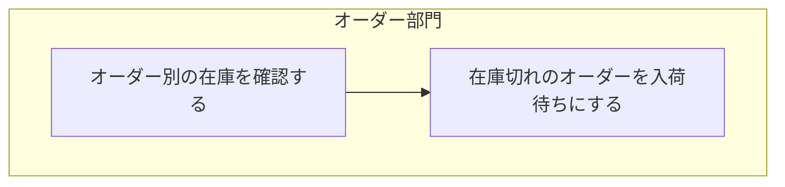

### オーダー処理 / 在庫切れのとき取引先に追加発注する

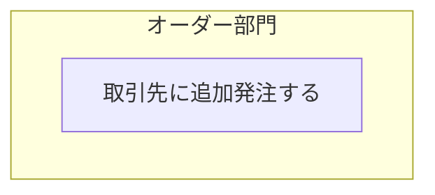

### オーダー処理 / 入金が確認されたオーダーの出荷指示を行う

```mermaid
flowchart TB
  subgraph l1["オーダー部門"]
    act2["出荷指示を行う"]
  end
  classDef hyp stroke-dasharray:5 5,stroke:#d97706,color:#92400e
```

### オーダー処理 / 入金の不足分の追加支払いを依頼する

```mermaid
flowchart TB
  subgraph l1["オーダー部門"]
    act2["顧客と差額を確認する"]
    act3["差額の追加支払いを依頼する"]
  end
  act2 --> act3
  classDef hyp stroke-dasharray:5 5,stroke:#d97706,color:#92400e
```

### オーダー処理 / 入金の過多分を返金する

```mermaid
flowchart TB
  subgraph l1["オーダー部門"]
    act2["顧客に連絡して差額を返金する"]
  end
  classDef hyp stroke-dasharray:5 5,stroke:#d97706,color:#92400e
```

### オーダー処理 / 返品を受け付ける

```mermaid
flowchart TB
  subgraph l1["オーダー部門"]
    act2["返品をメールもしくは電話で受け付ける"]
    act3["返品された代金を返金する"]
  end
  subgraph l4["物流"]
    act5["返品された商品を在庫に戻す"]
  end
  act2 --> act3
  act3 --> act5
  classDef hyp stroke-dasharray:5 5,stroke:#d97706,color:#92400e
  class act3,act5 hyp
```

### オーダー処理 / 配送終了を確認しオーダーを完了する

```mermaid
flowchart TB
  subgraph l1["オーダー部門"]
    act2["配送会社からの配送終了のメール通知を確認する"]
    act3["オーダーを完了する"]
  end
  act2 --> act3
  classDef hyp stroke-dasharray:5 5,stroke:#d97706,color:#92400e
```

### 出荷と入荷 / 締め毎に商品を出荷する

```mermaid
flowchart TB
  subgraph l1["物流"]
    act2["締め毎に出荷作業を行う"]
  end
  subgraph l3["出荷システム"]
    act4["出荷作業の完了を通知する"]
  end
  act2 --> act4
  classDef hyp stroke-dasharray:5 5,stroke:#d97706,color:#92400e
```

### 出荷と入荷 / 入荷情報を入荷システムに入力する

```mermaid
flowchart TB
  subgraph l1["物流"]
    act2["入荷情報を入荷システムに入力する"]
  end
  subgraph l3["入荷システム"]
    act4["入荷情報を発注と突き合わせる"]
    act5["入荷待ちのオーダーの入荷待ちを解除する"]
  end
  act2 --> act4
  act4 --> act5
  classDef hyp stroke-dasharray:5 5,stroke:#d97706,color:#92400e
  class act4 hyp
```

### 顧客の声の把握 / レビュー・感想を投稿する

```mermaid
flowchart TB
  subgraph l1["顧客"]
    act2["購入した商品のレビュー・感想を投稿する"]
  end
  classDef hyp stroke-dasharray:5 5,stroke:#d97706,color:#92400e
```

### 顧客の声の把握 / レビュー・感想を集計し商品開発に使う

```mermaid
flowchart TB
  subgraph l1["営業"]
    act2["商品ごとにレビュー・感想を集計する"]
    act3["商品開発を検討する"]
  end
  act2 --> act3
  classDef hyp stroke-dasharray:5 5,stroke:#d97706,color:#92400e
```

## 情報モデル

```mermaid
erDiagram
  %% コンテキスト: 商品
  i1["商品"]
  %% コンテキスト: 顧客
  i2["顧客"]
  %% コンテキスト: オーダー
  i3["カート"]
  i4["オーダー"]
  i5["入金"]
  i6["返品"]
  %% コンテキスト: 在庫
  i7["在庫"]
  i8["出荷指示"]
  i9["入荷"]
  %% コンテキスト: 発注
  i10["発注"]
  i11["取引先"]
  %% コンテキスト: 販売分析
  i12["売上"]
  %% コンテキスト: 顧客の声
  i13["レビュー"]
```

## 状態モデル

### オーダー状態

```mermaid
stateDiagram-v2
  state "受付済" as s1
  state "受理済" as s2
  state "入金待ち" as s3
  state "入金確認済" as s4
  state "入荷待ち" as s5
  state "出荷指示済" as s6
  state "出荷済" as s7
  state "完了" as s8
  state "キャンセル済" as s9
  state "返品受付済" as s10
  classDef hyp stroke-dasharray:5 5,stroke:#d97706,color:#92400e
  class s1,s3 hyp
```

### 商品状態

```mermaid
stateDiagram-v2
  state "取扱中" as s1
  state "追加発注しない" as s2
  state "取扱終了" as s3
```

### 発注状態

```mermaid
stateDiagram-v2
  state "発注済" as s1
  state "入荷済" as s2
  classDef hyp stroke-dasharray:5 5,stroke:#d97706,color:#92400e
  class s2 hyp
```
